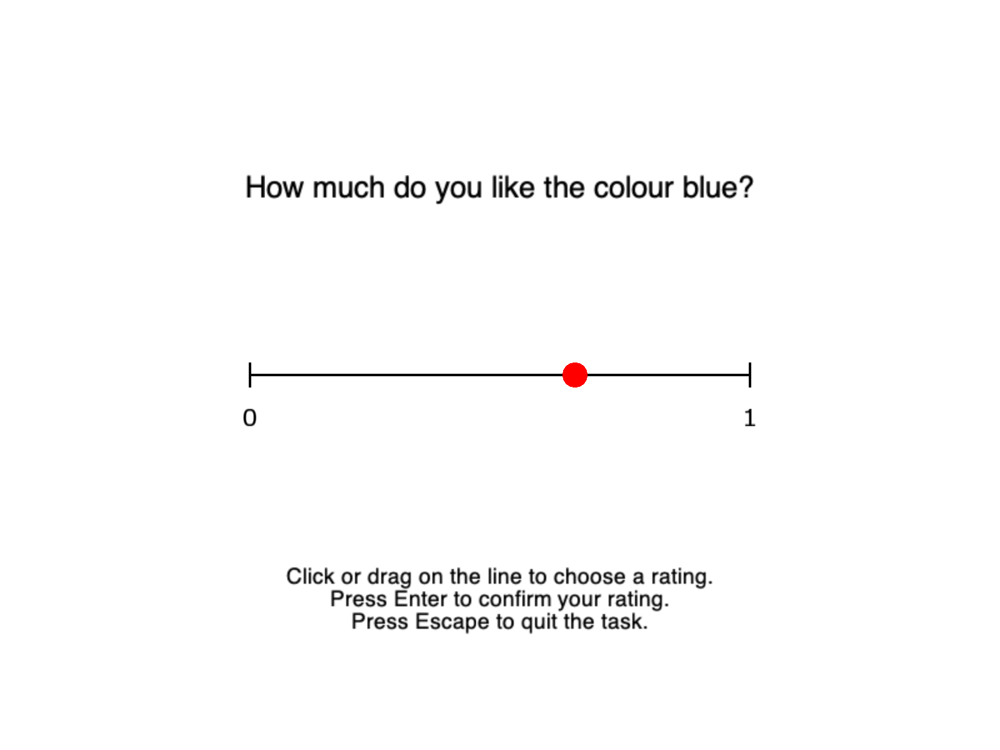

# PsychoPy Slider-Rating Demonstration

A small PsychoPy script that presents three neutral prompts, collects a rating on a
continuous 0–1 slider for each, and saves the confirmed responses to a CSV file.
It is a demonstration of slider response collection, not a validated experiment.



*Screenshot of the third prompt, rendered by PsychoPy 2026.2.4 during the simulated
test run described below. The marker position (0.65) was set by the test script, not by
a participant.*

## Repository contents

| Path | Purpose |
|------|---------|
| [slider_bar_psychopy.py](slider_bar_psychopy.py) | The demonstration script |
| [tests/simulated_session.py](tests/simulated_session.py) | Runs the script with scripted mouse/keyboard input and checks the CSV |
| [examples/demo_simulated_session.csv](examples/demo_simulated_session.csv) | **Demonstration data** from one simulated run, not a participant |
| [docs/slider_screenshot.png](docs/slider_screenshot.png) | Screenshot shown above |
| [LICENSE](LICENSE) | MIT licence |

## Requirements

- Python 3 with PsychoPy. Tested with PsychoPy **2026.2.4** on Python 3.12.6, macOS 27.0.1
  (see [Verification](#verification)).

```bash
pip install psychopy
```

## Running the task

```bash
python slider_bar_psychopy.py
```

For each prompt:

- **Click or drag** on the line to choose a rating. The scale is continuous
  (`granularity=0`) from 0 to 1, and the rating is registered when the mouse button is
  released.
- **Enter** confirms the rating and moves to the next prompt. It does nothing until a
  rating has been chosen. A rating of 0 is a valid response.
- **Escape** aborts the task. Trials already completed are kept.

The slider is reset at the start of each trial, so a previous response never carries over.
The script relies on PsychoPy's own `Slider` mouse handling (`draw()` and `getRating()`).
It does not compute the rating from the mouse position itself.

## Output

Each run writes `data/slider_ratings_<session_id>.csv`. The session ID is a timestamp
plus a random suffix, and the file is opened in exclusive-create mode, so a second run
never overwrites the first. Each trial's row is written and flushed as soon as the trial ends.

| Column | Meaning |
|--------|---------|
| `session_id` | Identifies the run |
| `trial_id` | Trial number within the run (1–3) |
| `prompt_id` | Identifies the question (`p1`–`p3`) |
| `prompt_text` | The question shown |
| `rating` | Confirmed rating, 0–1 (empty if aborted) |
| `confirmation_rt_s` | Seconds from the first frame showing the prompt to the Enter press that confirmed it |
| `last_rating_rt_s` | PsychoPy's `slider.getRT()`: seconds from the slider's first frame to the mouse release that set the confirmed rating. This is **not** the confirmation time |
| `status` | `completed`, or `aborted` for the trial on which Escape was pressed |

Both times come from the frame loop, so they have frame-level resolution (about 16.7 ms
at 60 Hz), and keypresses are polled once per frame. Timing precision has not been
measured. Do not treat these values as precise reaction times.

Example (demonstration data from the simulated run, so the times are a few frames):

```csv
session_id,trial_id,prompt_id,prompt_text,rating,confirmation_rt_s,last_rating_rt_s,status
20261013-145202-21b566,1,p1,How easy is this sentence to read?,0.0000,0.0500,0.0340,completed
20261013-145202-21b566,2,p2,How warm does the room feel right now?,1.0000,0.0251,0.0169,completed
20261013-145202-21b566,3,p3,How much do you like the colour blue?,,,,aborted
```

## Verification

**Automated (simulated input).** [tests/simulated_session.py](tests/simulated_session.py) runs
the unmodified script in a real PsychoPy window. It replaces only the slider's mouse and
PsychoPy's key reader with a frame-by-frame script, then checks the saved CSV:

```bash
python tests/simulated_session.py
```

Run on PsychoPy 2026.2.4, Python 3.12.6, macOS 27.0.1. All of the following passed:

- [x] Left endpoint gives 0 and right endpoint gives 1
- [x] A rating of 0 can be confirmed
- [x] Enter before any selection is ignored
- [x] The slider resets between trials (Enter at the start of trial 2 is ignored)
- [x] Escape aborts, and completed trials remain in the CSV
- [x] The CSV matches the scripted selections, and two runs write two separate files

**Manual (real mouse and keyboard).** Not yet done. Repeat the checks above by hand and
record the PsychoPy version and OS used here.

Timing accuracy was not measured in either case.

## License

The code is released under the [MIT License](LICENSE).
